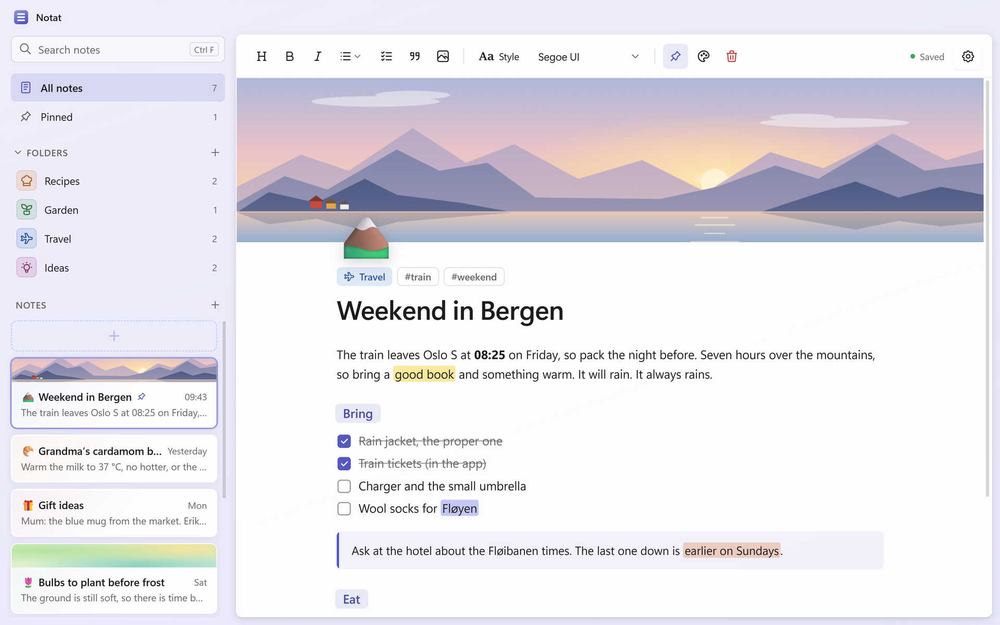
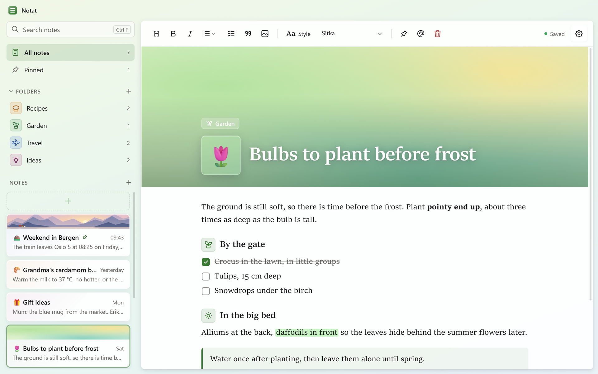
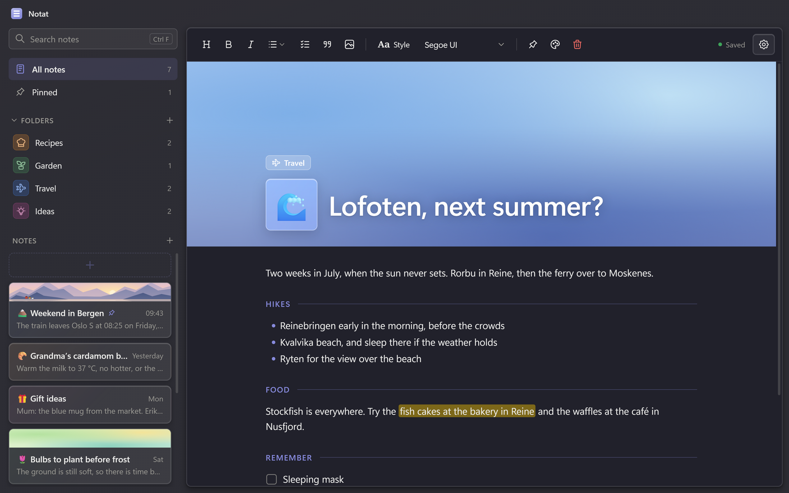
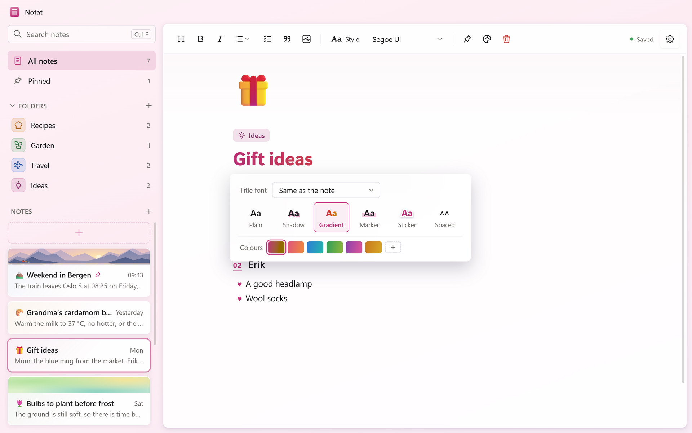
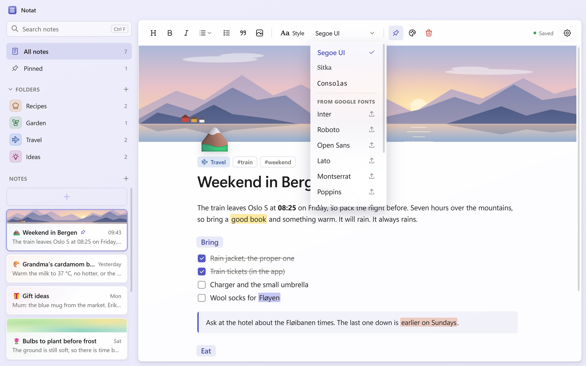
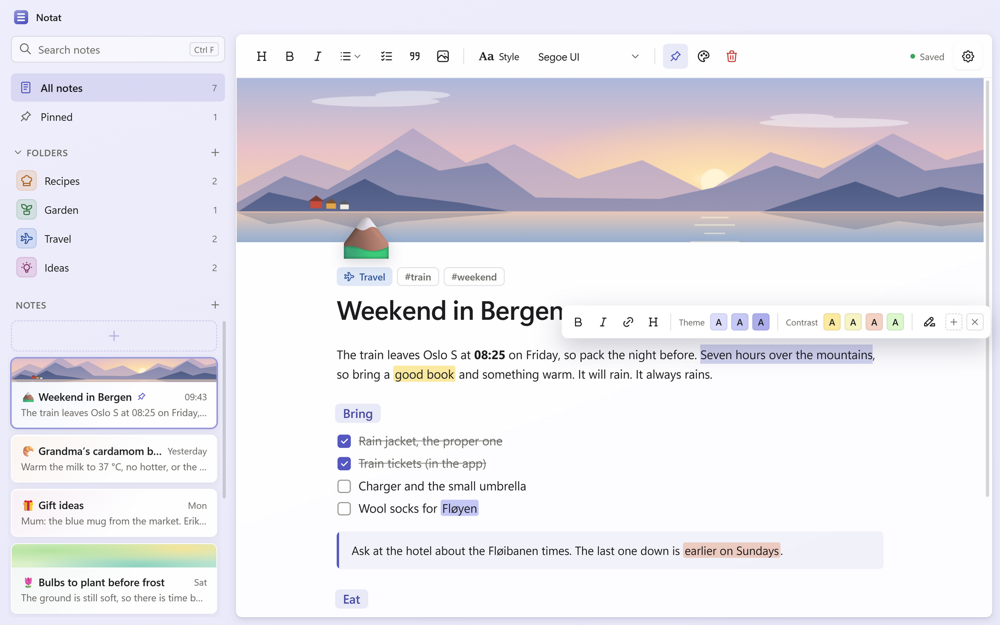
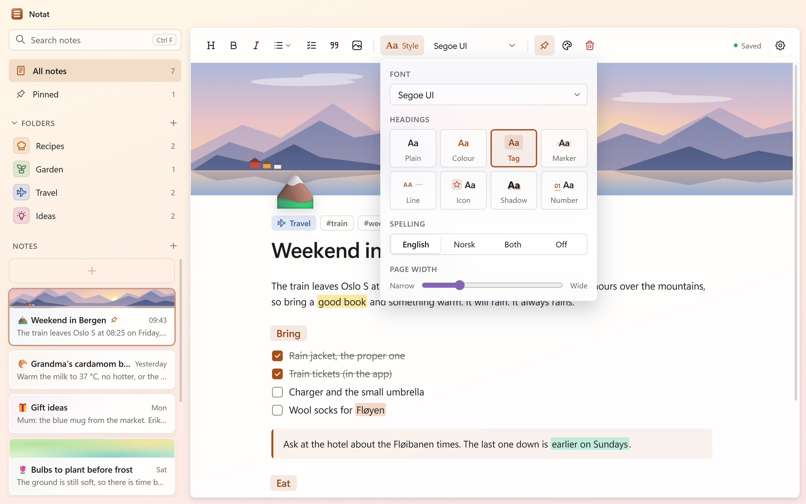
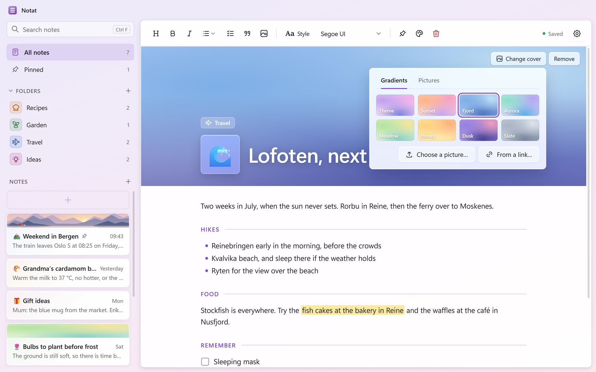
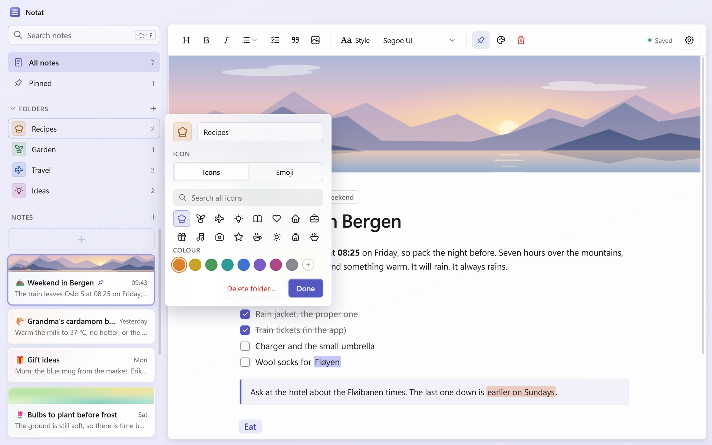
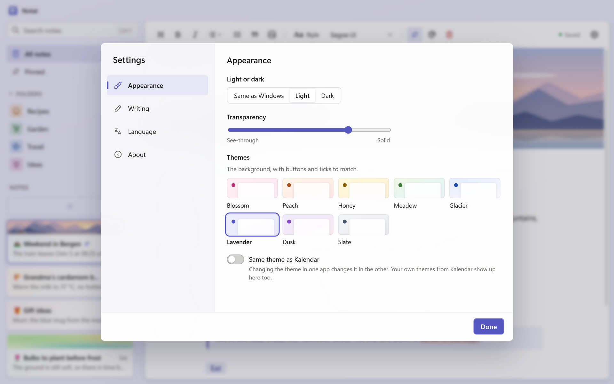

# Notat

**Calm, private notes for Windows.** Notat (Norwegian for *note*) is a small notes app made to sit next to [Kalendar](https://github.com/ecnot/kalendar). It has the same soft glass look, the same themes, and it can even share Kalendar's theme, so the two feel like one family.

Everything stays on your PC. There's no account, no cloud and no tracking.

## What it does

- **Write the way you like.** Headings, lists with your choice of bullets, checklists you can tick off, quotes, links and pictures. Paste or drop a picture straight into a note, make it smaller or larger, and let text sit beside it.
- **Covers and icons.** Give a note a cover (a soft gradient or one of your own pictures, sharp or blurred) and any emoji or one of almost 5,000 line icons, with search. Put the title on the cover for a magazine-like header.
- **Title styles.** Plain, Shadow, Gradient (in your own colours if you like), Marker, Sticker or Spaced, and the title can have its own font.
- **Fonts.** Segoe UI, Sitka and Consolas, ten popular Google Fonts one click away, and any other font from Google Fonts: paste its link in Settings. Fonts are downloaded once and kept on your PC. Select some text to give just that text another font.
- **Eight heading styles.** Plain, Colour, Tag, Marker, Line, Icon, Shadow or Number. Pick one for the whole note, or give a single heading its own style.
- **A colour for each note.** A note's colour takes the theme colour's place inside it: headings, quotes, ticks, bullets and the highlighter all follow.
- **A highlighter that matches.** Select some text and pick a colour: three shades of the note's colour, four contrasting colours chosen to go with it, your own, or whole sets of pastel highlighters (make your own from colour codes).
- **Spelling in English or Norwegian,** chosen for each note.
- **Folders with icons.** Pick an icon or emoji and any colour for each folder, drag notes into them, and fold the list away when you don't need it.
- **Pin, tag and search.** Pinned notes stay at the top. Search looks through titles, text and #tags.
- **Eight themes, light and dark.** The same pale gradients as Kalendar, with a transparency slider and Windows 11's frosted glass.
- **Same theme as Kalendar.** Switch it on in both apps, and changing the theme in one changes it in the other.
- **English and Norwegian (bokmål).**

<table>
<tr>
<td></td>
<td></td>
</tr>
<tr>
<td align="center">Title on the cover, Icon headings</td>
<td align="center">Dark mode, Line headings</td>
</tr>
<tr>
<td></td>
<td></td>
</tr>
<tr>
<td align="center">Click the title for its font and style</td>
<td align="center">Fonts, including Google Fonts</td>
</tr>
<tr>
<td></td>
<td></td>
</tr>
<tr>
<td align="center">The highlighter, in the note's colours</td>
<td align="center">Style: font, headings, spelling, width</td>
</tr>
<tr>
<td></td>
<td></td>
</tr>
<tr>
<td align="center">Gradient covers, or your own pictures</td>
<td align="center">Folders with icons and colours</td>
</tr>
</table>

## Keyboard

| Keys | What it does |
|---|---|
| Ctrl+N | New note |
| Ctrl+F | Search |
| Ctrl+B, Ctrl+I | Bold, italic |
| Ctrl+Alt+2 | Heading |
| Ctrl+Shift+9 | Checklist |
| Tab, Shift+Tab | Indent a list line, or move it back |
| Enter on an empty line | Leave a quote |
| Ctrl+click | Open a link |
| Esc | Close a popup |

## Privacy

Your notes are kept in `%APPDATA%\Notat` on your PC. Notat only goes online when you ask it to: to get a picture from a web address, or to download a font from Google Fonts (fonts.googleapis.com and fonts.gstatic.com). "Same theme as Kalendar" uses a small file on your PC (`%APPDATA%\Kalendar and Notat\shared-theme.json`) and never leaves it. Spelling uses Windows' own spell checker.

## Getting Notat

Notat is for Windows 10 and 11. Download the installer from the [Releases](https://github.com/ecnot/notat/releases) page. The frosted glass needs Windows 11 version 22H2 or newer; on older versions Notat uses a solid background instead. Norwegian spelling needs Norwegian (bokmål) added in Windows' language settings.

## Thanks

Icons from [Tabler Icons](https://tabler.io/icons) (MIT). Emoji names and keywords from [Emojibase](https://emojibase.dev) (MIT).
